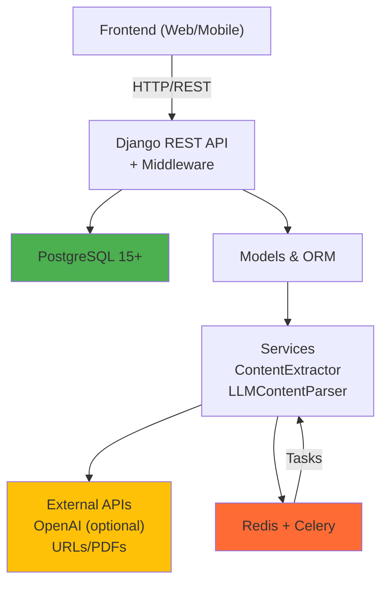

# 🏗️ System Architecture

This document describes the overall architecture of the CreditMate AI backend system, including components, data flow, and design decisions.

## Table of Contents

- [System Overview](#system-overview)
- [Architecture Diagram](#architecture-diagram)
- [Core Components](#core-components)
- [Data Flow](#data-flow)
- [Technology Stack](#technology-stack)
- [Directory Structure](#directory-structure)
- [Coding Standards](#coding-standards)

## System Overview

CreditMate AI is a Django-based AI-powered credit card discovery platform that automatically crawls, analyzes, and compares credit cards from banks across the web. The system is designed to be:

- **Scalable**: Distributed task processing with Celery
- **Maintainable**: Clear separation of concerns and well-documented code
- **Reliable**: Comprehensive error handling and monitoring
- **Secure**: Built-in protection against common vulnerabilities

## Architecture Diagram

**CreditMate AI Backend - Core Components**

```
┌─────────────┐
│  Frontend   │  (External web/mobile app)
└──────┬──────┘
       │ HTTP/REST
       ▼
┌──────────────────────────────────────────┐
│   Django REST API (DRF + Middleware)     │
│  - /api/v1/banks/                        │
│  - /api/v1/credit-cards/                 │
│  - CORS, Rate Limiting, Security         │
└──────────┬───────────────────────────────┘
           │
    ┌──────┴───────┐
    │              │
    ▼              ▼
┌─────────┐   ┌────────────────────────┐
│PostgreSQL   │ Services & Models      │
│(15+)        │ - ContentExtractor     │
│ banks       │ - LLMContentParser     │
│ cards       │ - CreditCardDataSvc    │
└─────────┘   │ - BankDataCrawlerSvc   │
              └────────┬───────────────┘
                       │
           ┌───────────┼───────────┐
           │           │           │
           ▼           ▼           ▼
        ┌────────┐ ┌─────────┐ ┌──────────┐
        │ Redis  │ │ OpenAI  │ │ External │
        │Celery  │ │  API    │ │  URLs    │
        │Queue   │ │(Optional)│ │ (PDFs)  │
        └────────┘ └─────────┘ └──────────┘
           ▲
           │
    ┌──────────────────────┐
    │ Celery Beat Scheduler│ (Periodic tasks)
    └──────────────────────┘

Optional: Elasticsearch (docker-compose.search.yml)
- Search index for credit cards (Stream 6.1)
- Separate from main stack
```

**Mermaid Diagram** (for visualization tools):


## Core Components

### 1. REST API Layer (`api/`)

**Purpose**: Handle HTTP requests and responses

**Key Responsibilities**:
- Accept REST API requests from clients
- Validate request parameters
- Serialize response data
- Handle authentication and permissions
- Apply rate limiting and throttling

**Main Classes**:
- `BanksViewSet` - Bank listing and retrieval
- `CreditCardsViewSet` - Credit card search and filtering
- `SearchSuggestionsViewSet` - Search autocomplete

### 2. Models & ORM (`models.py`)

**Purpose**: Define database schema and relationships

**Key Models**:

#### `Bank`
- Represents a financial institution
- Fields: `name`, `code`, `website`, `supported_card_types`
- Relations: one-to-many with `BankDataSource` and `CreditCard`

#### `BankDataSource`
- Represents a URL or data source for a bank
- Fields: `bank` (FK), `url`, `content_type`, `description`
- Content types: WEBPAGE, PDF, IMAGE, CSV
- Tracks: `last_crawled`, `is_active`

#### `CrawledContent`
- Raw content extracted from data sources
- Fields: `data_source` (FK), `content_hash`, `raw_content`, `extracted_text`
- Audit fields: `created_at`, `updated_at`

#### `CreditCard`
- Processed credit card product
- Fields: Name, issuer, APR, annual_fee, rewards, eligibility requirements
- Audit fields: `created_at`, `updated_at`

### 3. Services Layer (`services.py`)

**Purpose**: Encapsulate business logic

**Key Services**:

#### `ContentExtractor`
Extracts text from various content types:
- **PDF**: Extract text and images
- **WEBPAGE**: Fetch and parse HTML
- **IMAGE**: Extract text using OCR
- **CSV**: Parse tabular data

#### `LLMContentParser`
Uses OpenAI GPT to parse unstructured content:
- Converts extracted text to JSON structure
- Validates extracted data
- Handles parsing errors with retry logic

#### `CreditCardDataService`
Updates credit card database:
- Creates/updates credit card records
- Handles data deduplication
- Tracks data source relationships

#### `BankDataCrawlerService`
Orchestrates the entire crawling workflow:
1. Fetch active data sources
2. Extract content using `ContentExtractor`
3. Parse content using `LLMContentParser`
4. Update database using `CreditCardDataService`
5. Log results and errors

### 4. Task Queue (`tasks.py`)

**Purpose**: Handle asynchronous and scheduled tasks

**Key Tasks**:

#### `crawl_all_bank_data`
- Scheduled weekly (Monday 2 AM)
- Crawls all active bank data sources
- Updates credit card database

#### `crawl_data_source`
- Crawls a specific data source
- Called by crawler service
- Includes retry logic for failures

#### Error Handling Tasks
- `retry_failed_crawl` - Retries failed crawls
- `log_crawl_error` - Logs errors for monitoring

### 5. Database Layer (`models.py` + ORM)

**Purpose**: Persistent data storage

**Key Aspects**:
- PostgreSQL 15+ (docker-compose uses postgres:15, not 17)
- ORM abstractions for SQL queries
- Migration management with Django migrations
- Audit trails with `created_at` and `updated_at` fields

### Optional Components

**Elasticsearch** (docker-compose.search.yml)
- Status: **Optional** - Separate from main stack
- Purpose: Search index for credit cards (Stream 6.1)
- Configuration: Start with `docker-compose -f docker-compose.search.yml up -d`
- Port: 19200 (local development)
- Credentials: Disabled for local development only

**LLM Providers** (common/llm/)
- OpenAI/OpenRouter: Optional - required only for content parsing/crawling
- Google Gemini: Optional - fallback LLM provider
- Leave API keys empty if only using API for search/retrieval

**Sentry Error Monitoring** (credit_mate_ai/sentry.py)
- Status: **Optional** - Configuration support exists
- Implementation: **Unverified** - Not currently deployed
- Setup: Requires SENTRY_DSN environment variable

## Data Flow

### Crawling Workflow (Data Ingestion)

```
1. Schedule: Celery Beat triggers crawl_all_bank_data
                    ▼
2. Service: BankDataCrawlerService fetches active sources
                    ▼
3. Iterate: For each BankDataSource
                    ▼
4. Extract: ContentExtractor.extract_content()
            - Download content from URL
            - Parse format (PDF/HTML/CSV/Image)
            - Extract raw text
                    ▼
5. Parse: LLMContentParser.parse_content() (requires OPENAI_API_KEY)
          - Send to OpenAI GPT or Gemini API
          - Parse into structured JSON
          - Validate extracted data
          - Skip this step if no LLM provider configured
                    ▼
6. Update: CreditCardDataService.update_credit_cards()
           - Create/update CreditCard records
           - Link to BankDataSource
           - Track source and timestamp
                    ▼
7. Store: Save to PostgreSQL
          - CrawledContent (raw data)
          - CreditCard (processed data)
          - Audit timestamps
```

### API Query Workflow (Data Retrieval)

```
1. Request: Client sends GET /api/v1/credit-cards/?search=travel
                    ▼
2. Router: Django REST URLs dispatch to CreditCardsViewSet
                    ▼
3. Serialize: Convert query parameters to filters
                    ▼
4. Query: ORM builds SQL query with filters
                    ▼
5. Database: PostgreSQL executes query
                    ▼
6. Response: Serialize QuerySet to JSON
                    ▼
7. Return: HTTP 200 with paginated results
```

## Technology Stack

### Backend Framework
- **Django**: 5.2.2 - Web framework and ORM
- **Django REST Framework**: REST API toolkit
- **Gunicorn**: Production WSGI server

### Database & Caching
- **PostgreSQL**: 15+ (docker-compose.yml uses postgres:15) - Primary database
- **Redis**: 7+ (docker-compose uses redis:7-alpine) - Task queue and caching
- **django-redis**: Redis caching backend

### Task Queue & Scheduling
- **Celery**: Distributed task processing
- **Celery Beat**: Periodic task scheduling
- **Redis**: Message broker for Celery

### AI Integration (Optional)
- **OpenAI API**: GPT models for content parsing (OPTIONAL - required only for LLM parsing)
- **google-generativeai**: Gemini API fallback (OPTIONAL)
- **python-dotenv**: Environment variable management

### Content Processing
- **requests**: HTTP client for web scraping
- **BeautifulSoup4**: HTML parsing
- **PyPDF2/pdfplumber**: PDF text extraction
- **Pillow**: Image processing
- **pytesseract**: Optical character recognition (OCR)

### Development & Testing
- **pytest**: Test framework
- **pytest-django**: Django integration for pytest
- **pytest-cov**: Coverage reporting
- **black**: Code formatter
- **isort**: Import sorter
- **flake8**: Linting

### Security & Monitoring
- **django-cors-headers**: CORS support
- **django-ratelimit**: API rate limiting
- **djangorestframework-simplejwt**: JWT authentication (OPTIONAL)
- **sentry-sdk**: Error tracking (OPTIONAL - configuration exists but unverified in deployment)
- **cryptography**: Encryption utilities

### Utilities
- **python-decouple**: Settings management
- **dj-database-url**: Database URL parsing
- **pytz**: Timezone utilities

## Directory Structure

```
creditmate-ai-be/
├── credit_mate_ai/              # Django project settings
│   ├── settings.py              # Django configuration
│   ├── urls.py                  # URL routing
│   ├── asgi.py                  # ASGI config (async)
│   ├── wsgi.py                  # WSGI config (production)
│   ├── celery.py                # Celery configuration
│   └── sentry.py                # Error monitoring config
│
├── banks/                       # Bank & crawling app
│   ├── models.py                # Database models
│   ├── services.py              # Business logic (crawler, parsers)
│   ├── tasks.py                 # Celery tasks
│   ├── admin.py                 # Django admin
│   ├── apps.py                  # App configuration
│   ├── api/
│   │   ├── serializers.py       # REST serializers
│   │   ├── viewsets.py          # REST viewsets
│   │   └── urls.py              # API routing
│   ├── tests/                   # Bank app tests
│   ├── management/commands/     # Custom CLI commands
│   └── migrations/              # Database migrations
│
├── credit_cards/                # Credit card product app
│   ├── models.py                # Credit card models
│   ├── api/
│   │   ├── serializers.py       # REST serializers
│   │   ├── viewsets.py          # REST viewsets
│   │   ├── filters.py           # Query filters
│   │   ├── pagination.py        # Pagination
│   │   └── urls.py              # API routing
│   ├── tests/                   # Credit card tests
│   └── migrations/              # Database migrations
│
├── common/                      # Shared utilities
│   ├── models.py                # Base models
│   ├── llm/                     # LLM interfaces
│   ├── utils/                   # Helper functions
│   └── tests/                   # Common tests
│
├── docs/                        # Documentation
│   ├── api/                     # API documentation
│   ├── configuration/           # Setup guides
│   ├── development/             # Dev documentation
│   ├── operations/              # Operational guides
│   └── user/                    # User guides
│
├── manage.py                    # Django CLI
├── pytest.ini                   # Pytest configuration
├── pyproject.toml               # Project dependencies
├── Dockerfile                   # Container image
├── docker-compose.yml           # Production containers
├── docker-compose.dev.yml       # Development containers (Redis + Django only)
├── docker-compose.search.yml    # Elasticsearch (optional, Stream 6.1)
├── .env.example                 # Environment template
├── README.md                    # Project README
├── CLAUDE.md                    # Development guidelines
└── uv.lock                      # Dependency lockfile
```

## Coding Standards

### Function Naming Conventions

All functions and methods use **lowercase snake_case** with descriptive names:

```python
# Good ✓
def extract_content_from_url(self, url):
    """Extract content from URL."""
    pass

def parse_credit_card_data(self, raw_content):
    """Parse extracted content into credit card data."""
    pass

def validate_annual_fee(self, fee_amount):
    """Validate annual fee value."""
    pass

# Avoid ✗
def extractContent(self, url):  # camelCase
    pass

def parse_data(self, content):  # Not descriptive
    pass

def foo(self, bar):  # Unclear purpose
    pass
```

### Docstring Format

All public methods use **numpy-style docstrings** without type hints in signatures:

```python
def extract_content(self, url, content_type):
    """Extract content from URL based on content type.

    Parameters
    ----------
    url : str
        The URL to extract content from
    content_type : str
        The type of content to extract (PDF, WEBPAGE, IMAGE, CSV)

    Returns
    -------
    tuple of (str, str)
        First element is raw content, second is extracted text content

    Raises
    ------
    NetworkError
        For network-related connection or timeout errors
    ContentExtractionError
        For HTTP errors or general extraction failures
    """
    pass
```

### Private Methods

Private methods (prefixed with `_`) should still include docstrings for complex logic:

```python
def _record_no_changes(self, data_source, content_hash):
    """Record that content hasn't changed.

    Parameters
    ----------
    data_source : BankDataSource
        The data source being processed
    content_hash : str
        SHA256 hash of the content for change detection

    Returns
    -------
    None
    """
    pass
```

### Comments

- Default: **No comments** - use descriptive names instead
- Only add comments when WHY is non-obvious (hidden constraints, workarounds, subtle invariants)
- Don't reference current task or PR - those belong in commit messages

```python
# Good ✓
# Retry with exponential backoff to handle OpenAI rate limits
max_retries = 3
for attempt in range(max_retries):
    try:
        return openai.ChatCompletion.create(...)
    except RateLimitError:
        wait_time = 2 ** attempt
        time.sleep(wait_time)

# Avoid ✗
# Parse the data
result = parse(data)  # Comment describes WHAT, not WHY

# For the PR: Added retry logic (belongs in commit message)
```

### Import Organization

Follow the standard Python import order:

```python
# Standard library imports
import hashlib
import os
from typing import Optional

# Third-party imports
from django.db import models
from django.utils import timezone
from rest_framework import viewsets
import requests

# Local imports
from banks.models import Bank
from common.utils import retry_with_backoff
```

## Git Workflow

**Do not automatically create commits.** Only commit when explicitly requested.

Follow conventional commits format:

```bash
git commit -m "feat(banks): add multi-source validation"
git commit -m "fix(api): resolve rate limit calculation"
git commit -m "docs: update architecture guide"
git commit -m "test: add coverage for edge cases"
```

**Commit Types**:
- `feat`: New feature
- `fix`: Bug fix
- `docs`: Documentation changes
- `style`: Code style (formatting, missing semicolons, etc.)
- `refactor`: Code refactoring without feature change
- `test`: Adding or updating tests
- `chore`: Dependency updates, build config, etc.

## Next Steps

- **[Local Development Setup](./LOCAL_DEVELOPMENT.md)** - Step-by-step environment setup
- **[Deployment Runbooks](./DEPLOYMENT_RUNBOOKS.md)** - Production deployment procedures
- **[Environment Variables](../configuration/environment-variables.md)** - Complete configuration reference
- **[API Documentation](../api/)** - REST API endpoints and usage

---

**Questions?** See [setup-and-guidelines.md](./setup-and-guidelines.md) for more development details.
