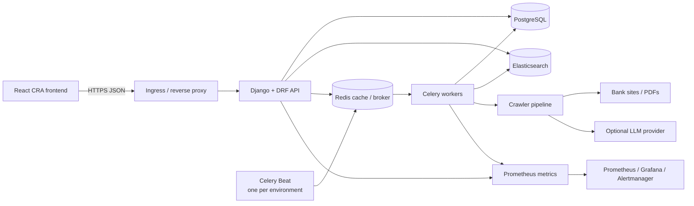

# Backend architecture and data model

## Components

The CRA frontend calls the versioned DRF API. Django owns validation, authentication/permissions, business operations, and PostgreSQL persistence. Redis supports cache and Celery messaging/results. Celery workers execute asynchronous work; Beat emits periodic work and must have a single active scheduler per environment. Search is indexed in Elasticsearch and can be rebuilt from persistent application data. The crawler retrieves configured bank sources, extracts web/PDF/image content, optionally uses an LLM to structure it, then stores source/content and product records. Prometheus metrics are exposed by the backend; dashboards and alert rules live in the parent DevOps repository's `monitoring/` tree.

## Data model map

The database is organized by Django app; migrations are the schema history.

- `banks`: `Bank` is the issuer; `BankDataSource` records source URLs and crawl metadata; `CrawledContent` stores fetched/extracted content, status, quality/confidence, and source relationship. Quality/review and validation records support the ingestion workflow.
- `credit_cards`: `CreditCard` belongs to a bank and stores normalized product terms (fees, APR, rewards, eligibility, benefits); `CreditCardFieldHistory` records field changes.
- `accounts`: Django users and account/authentication related records.
- `saved`: saved comparisons/collections and share tokens, associated with users.
- `reviews`: card reviews and votes, associated with users and cards.
- `alerts`: alert subscriptions/preferences and sent-alert deduplication records.
- `search`: search synchronization/outbox state; Elasticsearch is a derived index, not the system of record.

Use model foreign keys and uniqueness constraints as the source of relationship guarantees. Check the app `models.py` and migration files for authoritative field names/cardinality; this summary is intentionally conceptual. Do not edit historical migrations.

## Important paths

`credit_mate_ai/` contains settings, root URLs, middleware, health/readiness, metrics, and Celery app setup. Domain apps expose API URL modules and tasks locally. `docs/api/` describes API contracts. `docs/operations/observability.md` describes metric endpoints. For deployment, see [deployment runbook](DEPLOYMENT_RUNBOOKS.md).
